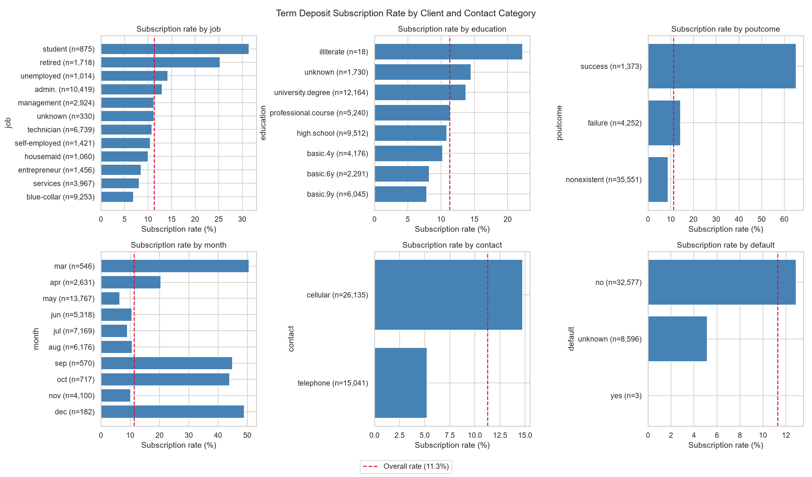
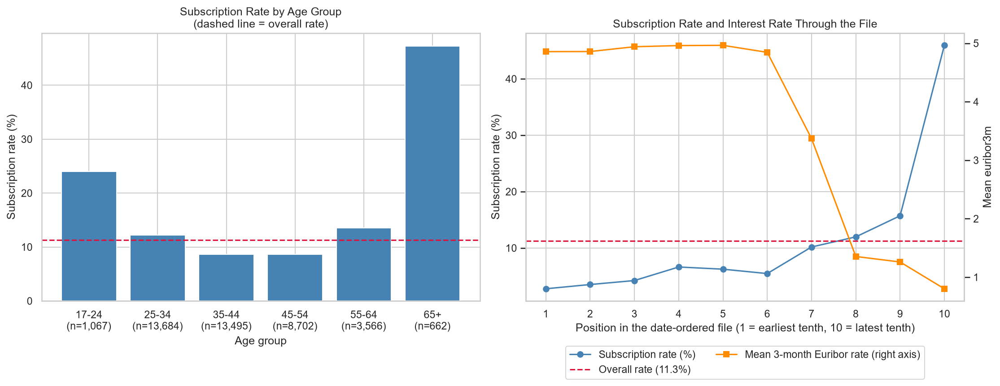
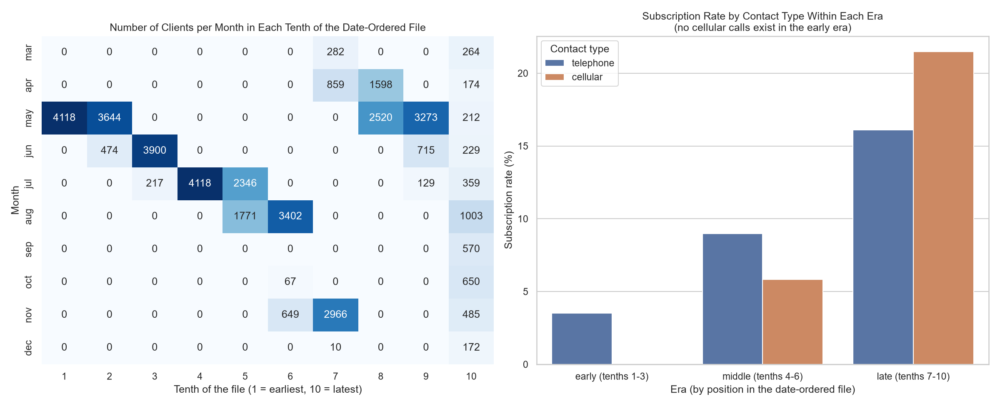
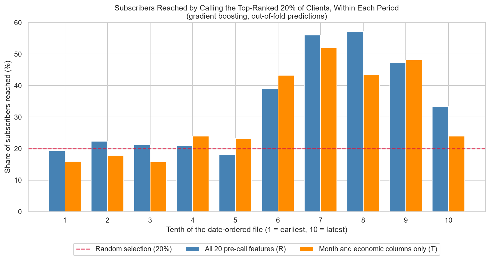
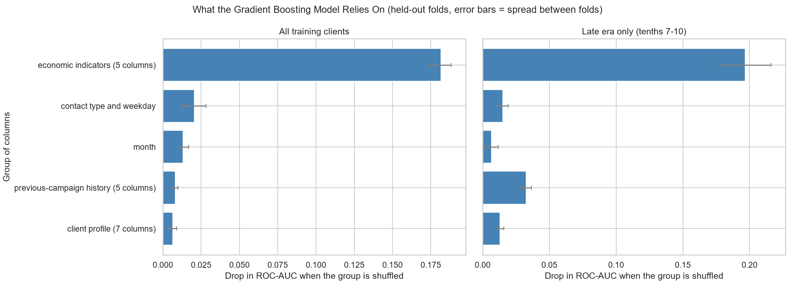

# Bank Marketing: Predicting Term Deposit Subscription

**An imbalanced-classification project that tests how well a prediction model really works: leakage, time effects and honest evaluation.**

I analysed 41,176 telephone marketing calls made by a Portuguese bank, to see what is associated with a client subscribing to a term deposit and how well subscription can be predicted before a call is made.

> **Short version:** the headline scores look good on a random split (ROC-AUC about 0.80), but a model that knows only *when* a call happened scores almost as high. Tested forward in time, the skill is weaker and depends on the model. Call duration is a leak. All findings are associations, not causes. The full write-up is in [REPORT.md](REPORT.md).

## Problem statement

Can we predict whether a client will subscribe to a term deposit using only information known before the call, and how much of the apparent predictive skill is real?

## Objectives

1. Clean and validate a real dataset, documenting every issue and decision.
2. Explore the data, including how it changes over time.
3. Build classification models with a baseline, metrics suited to imbalanced data, and cross-validation.
4. Check explicitly for data leakage and for time effects, and test forward in time.
5. Choose a call threshold under assumed costs, and see what the models rely on.
6. Report results and limitations without overstating them.

## Dataset

- **Source:** [Bank Marketing](https://archive.ics.uci.edu/dataset/222/bank), UCI Machine Learning Repository (dataset ID 222).
- **File used:** `bank-additional-full.csv`: 41,188 rows and 21 columns (20 inputs and the target `y`), ordered by date but with no year column.
- **Licence:** [Creative Commons Attribution 4.0 (CC BY 4.0)](https://creativecommons.org/licenses/by/4.0/).
- **Citation:** Moro, S., Rita, P., & Cortez, P. (2014). *Bank Marketing* [Dataset]. UCI Machine Learning Repository. https://doi.org/10.24432/C5K306
- **Target:** whether the client subscribed (11.27% did, after cleaning).

See [data/README.md](data/README.md) for details.

## Tools and technologies

Python 3.11, pandas, NumPy, Matplotlib, Seaborn, SciPy, scikit-learn, Git and GitHub. Exact versions are pinned in `requirements.txt`.

## Project structure

```
bank-marketing-classification/
├── data/
│   ├── README.md                    Source, licence and citation
│   └── bank-additional-full.csv     Original dataset (unmodified)
├── images/                          Charts produced by the scripts
├── src/
│   ├── load_data.py, inspect_data.py, investigate_quirks.py   Data checks
│   ├── clean_data.py                 Creates the cleaned dataset
│   ├── eda_01 ... eda_03             Exploratory analysis
│   ├── ml_common.py                  Shared helpers: feature sets, splits, metrics
│   └── ml_01 ... ml_09               Modelling and evaluation
├── REPORT.md                        Full findings report
├── README.md
├── requirements.txt
└── .gitignore
```

## Methodology

1. **Cleaning.** No empty cells. Removed 12 exact duplicate rows, kept "unknown" as its own category, and built a `previously_contacted` flag because the documented `pdays = 999` code did not match the data (4,110 clients with earlier contacts had `pdays = 999`). The raw file is never modified.
2. **Exploration.** Subscription rates by category, age and previous contact, and how the data changes through the date-ordered file.
3. **Leakage and time.** `duration` (known only after a call) and `campaign` (final value not known until calls end) are excluded from the realistic feature set, and their effect on the scores is measured. The row order is used as a clock, and the models are tested both on a random split and forward in time.
4. **Modelling.** An "always no" baseline, logistic regression (with and without class weights) and gradient boosting, in pipelines with default settings and no tuning. Choices were made by cross-validation on the training sides only. Each test side was scored once at the end.
5. **Evaluation.** ROC-AUC, PR-AUC compared with the test side's own subscription rate, and the share of subscribers reached by calling the top-ranked 20% of clients. Accuracy was not used, because always predicting "no" scores 88.7% on a random split.
6. **Interpretation.** Permutation importance on groups of related columns, plus a what-if analysis of call thresholds with assumed costs.

## Visualisations

Subscription rate by client and contact category:



Age and the subscription rate through the date-ordered file:



Months and contact types across the file, showing how time confounds other variables:



Subscribers reached by calling the top-ranked 20% of clients inside each period:



What the gradient boosting model relies on:



## Findings

All numbers are from the analyses in this repository.

**Patterns in the data**
- 11.27% of clients subscribed. Previous-campaign success had a 65.1% rate (1,373 clients), students 31.4% (875) and retired clients 25.3% (1,718). Telephone calls had a 5.2% rate and cellular calls 14.7%, but this is largely a time effect (see below).
- Subscription by age is U-shaped: 24.0% for ages 17 to 24, about 8.6% for 35 to 54, and 47.3% for 65 and over (662 clients).
- **Time confounds almost everything.** Across the date-ordered file, the subscription rate rises from 2.8% to 45.9% while the mean 3-month Euribor rate falls from 4.86 to 0.80. The first three tenths contain no cellular calls and no previously contacted clients.

**Modelling** (ROC-AUC on held-out test sides; each test side scored once)

| Model | Random split | Forward in time (train on the first 80%, test on the last 20%) |
|---|---|---|
| Logistic regression, 20 pre-call features | 0.801 | 0.748 |
| Gradient boosting, 20 pre-call features | 0.811 | 0.622 |
| Gradient boosting, month and economic columns only | 0.806 | 0.388 |
| Gradient boosting, plus `duration` (not realistic) | 0.952 | 0.772 |

- **Most of the random-split score is the clock.** A model that knew only the month and the economic indicators scored almost as high as the full model, and the models rely overwhelmingly on the economic indicators (shuffling them costs 0.12 to 0.20 ROC-AUC, about ten times more than any other group).
- **Forward in time the skill is weaker, and depends on the model.** Logistic regression stayed above chance (PR-AUC 0.528 against a test rate of 0.308), gradient boosting dropped to 0.622, and the clock-only model ranked backwards.
- **`duration` is a leak.** It raised ROC-AUC by about 0.14 to 0.15 for the same model in both splits but is not known before a call. `campaign` changed the scores by 0.007 or less.
- **Thresholds did not transfer when the base rate shifted.** A threshold that called 5.8% of earlier clients called 52.0% of later ones, and forward in time the model did not beat "call everyone" at the higher assumed values of a subscriber. The cost figures are assumptions, because the dataset has no costs or revenues.

Full details, tables and caveats are in [REPORT.md](REPORT.md).

## How to run

You need Python 3.10 or newer and Git. I used Python 3.11.

```bash
# 1. Get the code
git clone https://github.com/Anopa21/bank-marketing-classification.git
cd bank-marketing-classification

# 2. Create and activate a virtual environment
python -m venv .venv
# Windows (PowerShell):  .venv\Scripts\activate
# macOS / Linux:         source .venv/bin/activate

# 3. Install the libraries
pip install -r requirements.txt

# 4. Create the cleaned dataset (required before the other scripts)
python src/clean_data.py
```

Then run the scripts from the project root, in this order. Each prints its results, and some save charts to `images/`:

```bash
python src/eda_01_categorical.py
python src/eda_02_numeric_and_time.py
python src/eda_03_time_confounding.py
python src/ml_01_split_and_baseline.py
python src/ml_02_models_cv.py
python src/ml_03_period_test.py
python src/ml_04_within_period.py
python src/ml_05_gains.py
python src/ml_06_leakage_comparison.py
python src/ml_07_final_evaluation.py
python src/ml_08_thresholds.py
python src/ml_09_importance.py
```

On Windows PowerShell, if activating the environment is blocked, run `Set-ExecutionPolicy -Scope Process -ExecutionPolicy Bypass` first. The modelling scripts can take one to a few minutes each. Random seeds are fixed, so results should be repeatable.

`ml_07_final_evaluation.py` scores the held-out test sides, and I ran it once after all choices were fixed. Re-running it is fine for reproducing the numbers, but tuning against its output would defeat its purpose.

## Limitations

- One bank, one country, one campaign period. Results may not apply elsewhere.
- The file has no year column, so time is only available as row order. The documentation gives a date range that does not match the months in the data.
- Observational data: the findings are associations, and the variables overlap heavily with each other and with time.
- Models used default settings, with no tuning and no probability calibration.
- The forward-in-time test side is one specific stretch of the data, and bootstrap intervals ignore both the shift between periods and dependence between clients, so they are optimistic.
- The 12 duplicate rows were removed on judgment, and the documented coding of `pdays` does not match the data.
- Logistic regression was used for the threshold analysis after it did better on the test sides, so that analysis is an illustration.
- The costs and subscriber values in the threshold analysis are assumptions.

## Future improvements

- Obtain data with a real date column and a client ID, so time effects and duplicates can be handled properly.
- Use proper time-series validation, and calibrate probabilities for a shifting base rate.
- Tune the models, and compare more model types with nested cross-validation.
- Model the economic indicators more carefully, or exclude them and test how much client information alone adds.
- Add a small app that ranks clients, with a clear warning about the limits of the model.

## Data licence and attribution

The dataset is © its authors and used under CC BY 4.0. Please cite Moro, Rita and Cortez (2014) if you reuse it.

## Author

Anopa Machipisa · [GitHub: Anopa21](https://github.com/Anopa21)