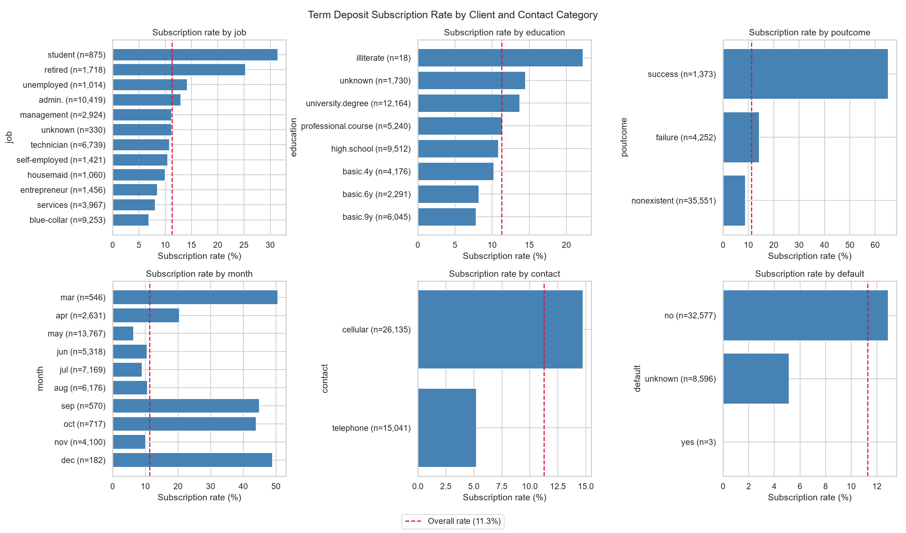
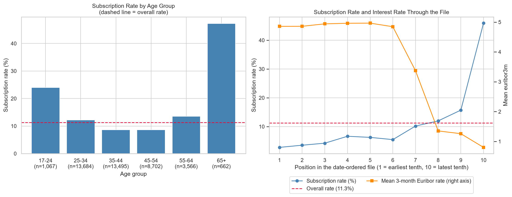
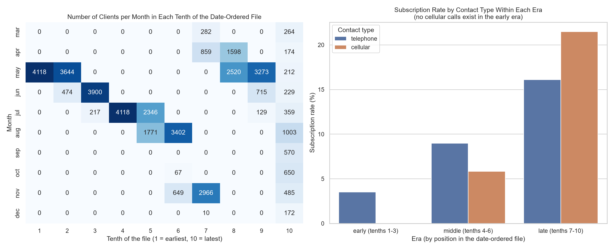
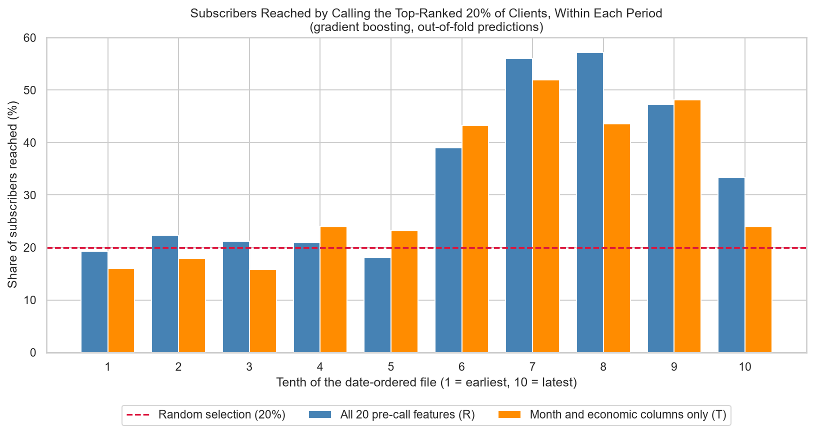
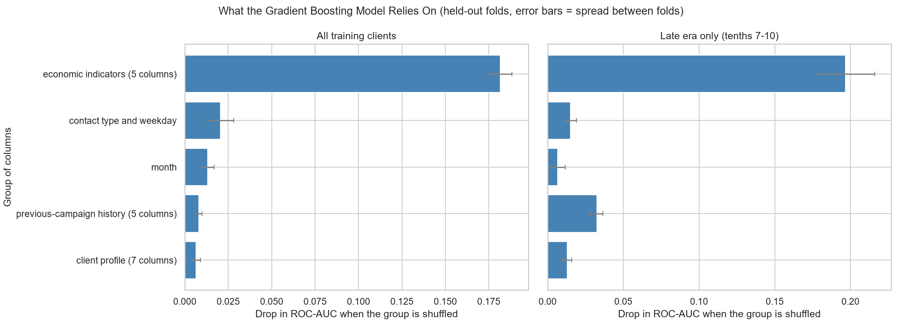

# Bank Marketing: Predicting Term Deposit Subscription

## 1. Summary

This project analysed 41,176 telephone marketing calls made by a Portuguese bank (UCI Bank Marketing dataset) to see which factors are associated with a client subscribing to a term deposit, and how well subscription can be predicted from information known before a call.

- 11.27% of clients subscribed. Always predicting "no" is right 88.7% of the time on a random split yet finds no subscriber, so accuracy was not used.
- Time confounds almost everything. The file is ordered by date, and across it the subscription rate rises from 2.8% to 45.9% while the mean 3-month Euribor rate falls from 4.86 to 0.80. The first three tenths of the file contain no cellular calls and no previously contacted clients, so several one-variable patterns (contact type, month, previous contact) are partly time effects.
- On a random test split, a model with 20 pre-call features reached ROC-AUC 0.80 to 0.81. A model using only month and the economic columns, with no information about the client, reached 0.806. Most of that score comes from recognising when a call took place.
- Tested forward in time (train on the first 80% of calls, test on the last 20%), logistic regression reached ROC-AUC 0.748, gradient boosting 0.622, and the clock-only model 0.388 (below chance). Skill forward in time is weaker and depends on whether the training period resembles the test period.
- Call duration is a leak. Adding it raised ROC-AUC by about 0.14 to 0.15 for the same model in both splits, but it is not known before a call.
- Probability thresholds did not transfer when the base rate shifted, and forward in time the model did not beat "call everyone" at the higher assumed values of a subscriber.
- The models rely mainly on the economic indicators (shuffling them costs 0.12 to 0.20 ROC-AUC). Client characteristics add little.
- All findings are associations in observational data. They do not show that any factor causes a client to subscribe.

## 2. Data

**Source:** UCI Machine Learning Repository, Bank Marketing (dataset ID 222), file `bank-additional-full.csv`. Licence: CC BY 4.0.
**Citation:** Moro, S., Rita, P., & Cortez, P. (2014). *Bank Marketing* [Dataset]. UCI Machine Learning Repository. https://doi.org/10.24432/C5K306

**Size:** 41,188 rows and 21 columns (20 inputs and the target `y`), separated by semicolons. The file is ordered by date but has no year column, so row order is the only record of time. The target has 36,548 "no" and 4,640 "yes" (11.3%).

## 3. Cleaning decisions

The raw file is never modified. A cleaned copy is generated by `src/clean_data.py`.

| Issue | What was found | Decision |
|---|---|---|
| Empty cells | 0 | None needed |
| Duplicate rows | 12 pairs of rows identical in every column (24 rows involved; 5 pairs on adjacent rows) | Removed the second copy of each pair (12 rows). There is no client ID, so these cannot be proven to be recording errors. The main reason was to avoid the same row appearing in both training and test data. |
| Text value "unknown" | `default` 8,597, `education` 1,731, `housing` 990, `loan` 990, `job` 330, `marital` 80 (raw counts); 26.0% of clients have at least one. `housing` and `loan` are unknown for exactly the same 990 clients. | Kept as its own category. Clients with unknown `default` subscribed at 5.2%, against 12.9% for known. |
| `pdays` code | The documentation says 999 means "not previously contacted". 39,673 rows have 999, but 4,110 of them have earlier contacts on record (`previous` above 0). | Built `previously_contacted` from `previous` above 0 (5,625 clients, consistent with `poutcome`), and `pdays_recorded` for the 1,515 clients with a real `pdays`. The raw column is kept. |
| `duration` equal to 0 | 4 rows, all "no" | Kept (`duration` is excluded from the realistic models anyway) |
| Extreme `campaign` | Median 2, maximum 56, 157 clients above 20 contacts | Kept. The column is excluded from the realistic models. |
| Time | No year column | Saved each row's original position (`original_row`) |

After cleaning: 41,176 rows, 36,537 "no" and 4,639 "yes" (11.27%).

## 4. Exploratory findings

**Categories** (subscription rate, with the number of clients):

| Variable | Highest | Lowest |
|---|---|---|
| Previous campaign outcome (`poutcome`) | success 65.1% (1,373) | nonexistent 8.8% (35,551) |
| Month | March 50.5% (546), December 48.9% (182), September 44.9% (570), October 43.9% (717) | May 6.4% (13,767) |
| Contact type | cellular 14.7% (26,135) | telephone 5.2% (15,041) |
| Job | student 31.4% (875), retired 25.3% (1,718) | blue-collar 6.9% (9,253) |

Housing loan, personal loan and weekday showed little difference (all within about 10% to 12%). `default = yes` has only 3 clients and `education = illiterate` only 18, so their rates mean nothing.

**Age** has a U-shape: 24.0% for ages 17 to 24, about 8.6% for 35 to 54, and 47.3% for 65 and over (662 clients). A plain linear correlation with age is about zero (-0.012), which hides this.

**Earlier contacts:** subscription rises from 8.8% with none (35,551 clients) to 21.2% with one, 46.4% with two and 58.7% with three or more (310 clients).

**Number of contacts in this campaign:** the rate falls from 13.0% for one contact to 3.1% for 11 or more. This is consistent both with "calls stop once a client subscribes" and with "uninterested clients keep being called", and the data cannot separate them.

**Change over time.** Cutting the date-ordered file into ten equal parts:

| Tenth | Subscription rate | Mean `euribor3m` | Cellular calls |
|---|---|---|---|
| 1 | 2.8% | 4.86 | 0% |
| 3 | 4.2% | 4.94 | 0% |
| 5 | 6.2% | 4.96 | 91.2% |
| 7 | 10.2% | 3.37 | 91.9% |
| 9 | 15.7% | 1.26 | 91.0% |
| 10 | 45.9% | 0.80 | 84.9% |

Grouped into three eras by position in the file:

| Era | Clients | Subscription rate | Previously contacted | Earlier success |
|---|---|---|---|---|
| Early (tenths 1 to 3) | 12,353 | 3.5% | 0.0% | 0.0% |
| Middle (tenths 4 to 6) | 12,353 | 6.1% | 1.1% | 0.0% |
| Late (tenths 7 to 10) | 16,470 | 21.0% | 33.4% | 8.3% |

Within eras, the contact-type effect is not consistent. In the middle era, telephone calls (9.0%, 1,103 clients) beat cellular calls (5.8%, 11,250), and in the late era cellular calls (21.5%, 14,885) beat telephone calls (16.1%, 1,585). The early era has no cellular calls. The overall cellular advantage (14.7% against 5.2%) is therefore mostly a time effect, because 12,353 of the 15,041 telephone calls fall in the early era. Almost all the earlier-success clients, and a large part of the student and retired clients, also fall in the late era, so several one-variable patterns above are tangled up with time.

## 5. Modelling approach

**Task:** predict whether a client subscribes, using only information known before the call.

**Features.** The realistic set R has 20 columns: the client profile (age, job, marital status, education, credit default, housing loan, personal loan), contact type, month and weekday, the previous-campaign history (`previous`, `poutcome`, a numeric `pdays` with the two flags), and the five economic indicators. Excluded from R: `duration` (known only after the call), `campaign` (its final value is not known until the calls end), `original_row` (a clock) and the raw `pdays`. Comparison sets: E (R without the economic columns), D (R plus `campaign`), F (R plus `campaign` and `duration`, not realistic) and T (month and the economic columns only, which knows when a call happened and nothing about the client).

**Splits.** A random stratified 80/20 split (32,940 training and 8,236 test clients, 11.3% subscribers on both sides), and a chronological 80/20 split (first 80% of the file for training, last 20% for testing: 6.4% subscribers in training and 30.8% in the test side).

**Models.** An "always no" baseline, logistic regression, logistic regression with balanced class weights, and gradient boosting (scikit-learn `HistGradientBoostingClassifier`), all with default settings and no tuning. Text columns are one-hot encoded and numeric columns scaled inside pipelines.

**Evaluation.** Choices were made by cross-validation on the training sides only. The test sides were scored once at the end. Metrics: ROC-AUC, PR-AUC compared with the test side's own subscription rate (the PR-AUC of a useless model), and the share of subscribers reached by calling the top-ranked 20% of clients. Accuracy was not used.

## 6. Results

### 6.1 Baseline

An "always no" model finds no subscriber but scores accuracy 0.887 on the random split and 0.692 on the chronological split. Its ROC-AUC is 0.5, and its PR-AUC equals the test subscription rate (0.113 and 0.308).

### 6.2 Cross-validation on the training sides

On the random folds, the three models were close (ROC-AUC 0.789 to 0.798, PR-AUC 0.444 to 0.459, against a base rate of 0.113). Class weights changed the behaviour at the 0.5 cut-off and not the ranking: plain logistic regression had precision 0.660 and recall 0.230, the balanced version precision 0.354 and recall 0.621.

On time-ordered folds (train on earlier calls, validate on the next block), the same models showed no measurable skill: ROC-AUC 0.498 to 0.533 and PR-AUC 0.075 to 0.085, against a base rate of 0.071. , Separately, 5-fold cross-validation with random folds, run inside each of three eras of the file (early, middle and late), gave ROC-AUC of 0.51 to 0.54 in the early era, 0.52 to 0.56 in the middle era and 0.78 to 0.81 in the late era (all 20 features, or without the economic columns; logistic regression and gradient boosting).

### 6.3 How much of the score is the clock?

| Features | Pooled ROC-AUC (LR / GB) | Mean ROC-AUC within a tenth of the file (LR / GB) |
|---|---|---|
| All 20 pre-call features (R) | 0.788 / 0.798 | 0.596 / 0.615 |
| Month and economic columns only (T) | 0.777 / 0.791 | 0.541 / 0.595 |

A model that knew only when a call happened scored almost as high as the full model when all calls were scored together, so most of the pooled score is period recognition. Within a tenth of the file, the client-level columns added about 0.02 ROC-AUC for gradient boosting and about 0.055 for logistic regression. The clearest gain was in the last tenth (0.719 against 0.598 for gradient boosting).

Calling the top-ranked 20% of clients inside each period reached 23.5% of subscribers in tenths 1 to 6, the same as the clock-only model (23.3%) and barely above random selection (20%). In tenths 7 to 10 it reached 48.5%, against 41.9% for the clock-only model. This still uses the month and economic columns, so it overstates what client information alone gives.

### 6.4 Leakage: `duration` and `campaign`

| Features | Random folds ROC-AUC (LR / GB) | Time-ordered folds ROC-AUC (LR / GB) |
|---|---|---|
| R, 20 pre-call | 0.789 / 0.798 | 0.533 / 0.498 |
| D, R plus `campaign` | 0.790 / 0.800 | 0.535 / 0.505 |
| F, R plus `campaign` and `duration` | 0.934 / 0.949 | 0.850 / 0.901 |

`duration` is the leak: it lifts the scores sharply in both splits, including forward in time, but it is not known before a call. `campaign` changed the scores by 0.007 or less, which is within the fold-to-fold spread. That does not prove it is safe, and it is excluded for the timing reason above.

### 6.5 Final evaluation on the held-out test sides

Each test side was scored once, with default settings, no tuning. Intervals are 95% bootstrap intervals over the test clients. They do not account for the shift between training and test periods.

| Split | Model | ROC-AUC | PR-AUC | Test rate | Top-20% reach |
|---|---|---|---|---|---|
| Random | Logistic regression, R | 0.801 [0.784, 0.819] | 0.451 [0.417, 0.488] | 0.113 | 64.2% |
| Random | Gradient boosting, R | 0.811 [0.794, 0.829] | 0.482 [0.448, 0.516] | 0.113 | 66.2% |
| Random | Gradient boosting, clock only (T) | 0.806 [0.789, 0.824] | 0.415 [0.386, 0.450] | 0.113 | 64.1% |
| Random | Gradient boosting, with `duration` (F) | 0.952 [0.947, 0.957] | 0.673 [0.643, 0.708] | 0.113 | 89.0% |
| Chronological | Logistic regression, R | 0.748 [0.736, 0.759] | 0.528 [0.508, 0.550] | 0.308 | 38.6% |
| Chronological | Gradient boosting, R | 0.622 [0.609, 0.636] | 0.418 [0.400, 0.437] | 0.308 | 31.4% |
| Chronological | Gradient boosting, clock only (T) | 0.388 [0.374, 0.401] | 0.298 [0.285, 0.312] | 0.308 | 20.7% |
| Chronological | Gradient boosting, with `duration` (F) | 0.772 [0.762, 0.782] | 0.558 [0.537, 0.578] | 0.308 | 38.9% |

- **Random split:** the full model and the clock-only model are within 0.005 ROC-AUC of each other (0.811 and 0.806, intervals overlapping). On PR-AUC the full model is ahead (0.482 against 0.415), with intervals that just touch.
- **Forward in time:** logistic regression is clearly above chance (PR-AUC 0.528 against 0.308, calling the top 20% reaches 38.6% of subscribers, a lift of 1.7 on the PR-AUC). Gradient boosting is weaker (0.622), and the clock-only model ranks backwards (0.388).
- **Before running the test I expected the forward-in-time score for the realistic features to be near 0.5, based on cross-validation. That was wrong for logistic regression (0.748).** A plausible reason is that the final training side (the first 80% of the file) includes the middle of the late era, where earlier-contacted clients appear, whereas the early training blocks used in cross-validation did not. This explanation was not tested.
- **On the random test side, inside each era** (ROC-AUC for logistic regression, gradient boosting, clock-only): early 0.500, 0.514, 0.547 (87 subscribers); middle 0.580, 0.604, 0.620 (140 subscribers); late 0.806, 0.822, 0.797 (701 subscribers). The client-level columns add little in any era.

**A note on model choice.** Both models were fixed in advance and both are reported. Logistic regression scored far higher than gradient boosting forward in time. Using it alone for the threshold analysis below was a choice made after seeing the test results, so that analysis should be read as an illustration.

### 6.6 Choosing a probability threshold

The dataset has no costs or revenues. The following is a what-if with assumed values: each call costs 1 unit, and a subscriber is worth V units, with V set to 5, 10 and 20. These are assumptions, not data. Thresholds were chosen on the training side and applied once to the test side, using logistic regression.

On the random split, predicted probabilities were well calibrated (mean 0.113 on training and 0.112 on the test side, against an actual 0.113). On the chronological split they were not: the model predicted a mean of 0.261 on the test side, but the actual rate was 0.308.

Net gain per 1,000 clients on the test side:

| V | Random split: model | Random: call everyone | Chronological: model | Chronological: call everyone |
|---|---|---|---|---|
| 5 | 181 | -437 | 656 | 541 |
| 10 | 532 | 127 | 1,896 | 2,083 |
| 20 | 1,320 | 1,254 | 5,156 | 5,166 |

- On the random split, selecting clients beat calling everyone clearly at V of 5 and 10, and only slightly at 20 (calling everyone pays when a subscriber is worth more than 8.9 calls).
- **The threshold chosen on the training side did not transfer forward in time.** A threshold of 0.16 called 5.8% of the training clients but 52.0% of the test clients. At V of 10 and 20 the model did not beat calling everyone (1,896 against 2,083, and 5,156 against 5,166), because the test base rate was already high (calling everyone pays above 3.2 calls per subscriber).

### 6.7 What the models rely on

Drop in ROC-AUC when a group of related columns is shuffled together among held-out clients (gradient boosting and logistic regression, on all training clients and on the late era only):

| Group | GB, all | LR, all | GB, late | LR, late |
|---|---|---|---|---|
| Economic indicators (5 columns) | 0.182 | 0.140 | 0.197 | 0.119 |
| Contact type and weekday | 0.020 | 0.030 | 0.015 | 0.009 |
| Month | 0.013 | 0.025 | 0.007 | 0.025 |
| Previous-campaign history (5 columns) | 0.008 | 0.013 | 0.032 | 0.038 |
| Client profile (7 columns) | 0.006 | 0.003 | 0.013 | 0.012 |

The models rely overwhelmingly on the economic indicators, which describe when a call took place and nothing about the client. Previous-campaign history matters more in the late era. The single-column results disagree between the two models (for example, `nr.employed` for gradient boosting and `emp.var.rate` for logistic regression), because the five economic columns are heavily correlated, so only the group-level numbers are reported. The logistic regression coefficients for these columns largely cancel each other (for example, -2.2 for `emp.var.rate` and +1.1 for `cons.price.idx`) and say nothing about the effect of any one economic factor.

## 7. Suggestions supported by the findings

These are ideas for further investigation. The data cannot show that acting on them would change results.

1. **Do not use call duration, or the final number of contacts, to decide whom to call before a call.** `duration` raises ROC-AUC by about 0.14 to 0.15 but is not known in advance. Whether it would help for follow-up after a call was not tested.
2. **Evaluate any targeting model on later calls, not on a random sample.** The random split reported ROC-AUC 0.80 to 0.81, while the forward-in-time scores were 0.388 to 0.748 depending on the model.
3. **Re-tune the call threshold whenever the base rate changes.** A threshold chosen on earlier calls called 5.8% of earlier clients but 52.0% of later ones.
4. **Keep track of previous-campaign outcomes.** An earlier success showed a 65.1% subscription rate, and this group of columns mattered more in the late era. It covers only 3.3% of clients, and most are in the late period.
5. **Record the call date (including the year), a client ID and the real cost and revenue figures.** With those, duplicates, time effects and the value of a threshold could be assessed properly.

## 8. Limitations

- One bank, one country, one campaign period. The results may not apply elsewhere.
- No year column. Eras are crude slices by row position, and the documentation gives May 2008 to November 2010 as the date range, yet December calls appear in the data. This was not resolved.
- Observational data. The findings are associations, and variables overlap heavily with each other and with time.
- Models used default settings with no tuning, no probability calibration, and no time-series methods.
- The chronological test side is one specific stretch of the data (the last 20%), and clients within a period are not independent, so the bootstrap intervals are optimistic.
- The 12 duplicate rows were removed on judgment, and the documentation's description of `pdays` does not match the data.
- Choosing logistic regression for the threshold analysis was influenced by the test results (see 6.5).
- The "value of a subscriber" figures are assumptions for illustration. The dataset has no costs or revenues.

## 9. Reproducibility

All scripts are in `src/` and are run from the project root in numbered order: data checks (`load_data.py`, `inspect_data.py`, `investigate_quirks.py`, `clean_data.py`), exploratory analysis (`eda_01` to `eda_03`), and modelling (`ml_common.py`, `ml_01` to `ml_09`). Random seeds are fixed (42), so results are repeatable. Charts are saved in `images/`.